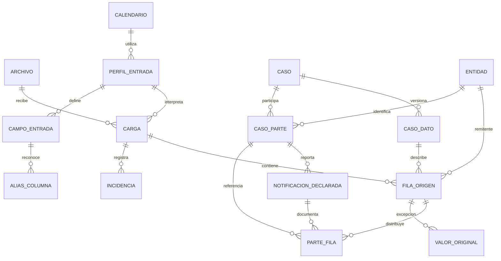

# Modelo de datos para consolidar reportes Sábana

Este modelo corresponde al proceso independiente de Junta Regional Bogotá. Recibe un Excel por solicitud, conserva una sola identidad de caso y permite varias entidades por rol. Los archivos permanecen en SharePoint; SQL guarda hechos tipados, referencias de procedencia y excepciones. La salida `rep.vw_consolidado_sabana` conserva las 85 columnas y la granularidad de las filas originales.

El diseño parte de 334 archivos, 12.939 filas y 11.167 llaves de caso observadas. Hay 1.335 casos con dos nombres de aseguradora distintos. Un caso aparece en varios archivos en 137 ocasiones. La entidad remitente presenta valores distintos en 569 llaves: por eso pertenece a la observación de origen y no se sobrescribe como atributo único del caso.

**Relaciones y granularidad.**

| Tabla | Una fila representa | Regla de identidad |
|---|---|---|
| `core.caso` | Un caso en una sala y audiencia | Sala, fecha de audiencia, reparto e identificación como texto |
| `core.caso_dato` | Una versión distinta de los datos reportados del caso | Caso y hash de los atributos tipados |
| `core.entidad` | Una denominación observada de entidad o empleador | Hash del nombre exacto; no hace fusiones aproximadas |
| `core.caso_parte` | Una persona o entidad participante en un rol | Caso, rol y entidad; paciente sin entidad; referencia de origen si no hay nombre |
| `core.notificacion_declarada` | Una versión distinta de los datos de notificación reportados para una parte | Parte y hash de atributos tipados |
| `ing.archivo` | Un archivo lógico de SharePoint | `drive_id` e `item_id`, sensibles a mayúsculas; mantiene el puntero a la carga vigente |
| `ing.carga` | Un contenido y una interpretación concretos de ese archivo | Archivo, SHA-256 del contenido e ID de perfil |
| `ing.fila_origen` | Una fila no vacía del Excel interpretado | Carga, hoja y número físico de fila |
| `ing.parte_fila` | El bloque de un rol en una fila original | Fila y rol; enlaza el detalle con la parte y su notificación |
| `ing.valor_original` | Un valor que exige conservar una excepción o transformación significativa | Fila y campo; no replica las 50 celdas de cada fila |
| `ing.incidencia` | Un problema de archivo, fila, mapping o interpretación | ID propio y referencias al origen |
| `cfg.perfil_entrada` | Una versión del mapping, parser, modelo y calendario | Nombre y versión; se congela al publicar |
| `cfg.campo_entrada` | Un campo esperado del perfil | Perfil y nombre del campo; declara tipo, orden y obligatoriedad |
| `cfg.alias_columna` | Un alias aprobado que identifica un campo | Perfil y alias normalizado; un alias no apunta a dos campos |
| `cfg.calendario` | Una versión explícita del calendario de cálculo | Nombre y versión |
| `cfg.dia_calendario` | Un día y su acumulado de días hábiles | Calendario y fecha |

Las cinco tablas `core` almacenan los hechos. Las demás resuelven configuración, procedencia y control. El ahorro depende de compartir hechos y evitar copias de texto, no de reducir el número de tablas. Los índices compuestos adicionales permiten que las claves foráneas impidan asociar una fila con datos o notificaciones de otro caso.

**Dos aseguradoras y varias filas.** Un caso con A y B tiene un solo `core.caso`, normalmente un solo `core.caso_dato`, dos `core.caso_parte` y sus observaciones de notificación. Las filas 2 y 3 del Excel mantienen referencias a A y B respectivamente. La vista devuelve ambas filas, sin producto cartesiano ni selección arbitraria con `MAX` entre aseguradoras. El paciente no se duplica por cada aseguradora.

`caso_dato` y `notificacion_declarada` son instantáneas inmutables, no intentos de envío ni pruebas de recepción. Si los mismos datos reaparecen en otra fila, archivo o perfil, se reutiliza el ID correspondiente. Si cambian los datos, se crea una instantánea nueva y se conserva su procedencia. Si dos fuentes vigentes se contradicen, ambas observaciones siguen visibles; no se elige la última por ID ni se confunden con dos reenvíos.

La entidad se cataloga por su denominación exacta, incluidos espacios y mayúsculas, para conservar lo reportado y evitar uniones indebidas. Este catálogo no constituye una identificación jurídica por NIT. Una futura conciliación de nombres requiere correspondencias revisadas y no debe alterar observaciones históricas. Los marcadores `NO APLICA` no crean entidades ficticias.

**Mapping y fechas.** El catálogo inicial contiene los 50 encabezados canónicos. El orden ayuda a reconocer una plantilla, pero el mapping se realiza por nombres normalizados y alias aprobados. La función debe comprobar una correspondencia uno a uno antes de cargar filas.

Si falta un encabezado, puede proponer una inferencia basada en el bloque completo, los vecinos y el perfil de los valores. Solo se acepta cuando la correspondencia es inequívoca; se registra el método y la evidencia en `estructura_origen_json` y una incidencia. No se registra el alias universal `NO APLICA → eps`. Las columnas vacías fuera del esquema se ignoran; columnas desconocidas con datos se señalan con su posición y se conservan en el Excel original.

El perfil inicial procesa únicamente la primera hoja del reporte, observada como `hoja1`, y busca los encabezados en la primera fila. No concatena automáticamente otras hojas: el archivo que también tiene `Hoja2` mantiene el comportamiento del script de referencia. Una plantilla que cambie esa disposición requiere un perfil nuevo.

El parser de la futura Function deberá distinguir fecha nativa, texto ISO, año/mes/día, día/mes/año según el perfil, formato compacto `YYYYMMDD` y serie numérica de Excel usando `workbook.epoch`. El perfil inicial declara día/mes/año para los formatos locales. Nunca se prueba automáticamente el formato estadounidense como segunda interpretación de un texto ambiguo.

Una fecha sintácticamente válida también debe pertenecer al rango del perfil. El año 8202 observado no se convierte en una fecha de envío válida para calcular millones de días. Para una fecha opcional inválida, ambigua o fuera de rango: guardar `NULL` en el hecho tipado, conservar el original en `ing.valor_original` y emitir incidencia W. La vista puede mostrar ese original, pero los indicadores usan exclusivamente la fecha tipada. Si falla una llave obligatoria o el mapping obligatorio, emitir E y no publicar parcialmente el archivo.

`mostrar_en_consolidado=1` muestra el valor original de una excepción, por ejemplo una fecha imposible. Una fecha recuperada como `20260723` se conserva como excepción con `mostrar_en_consolidado=0`, mientras la vista presenta `2026-07-23`. No se guardan de nuevo todas las fechas ISO correctamente interpretadas.

**Marcadores sin repetir cadenas.** `ing.parte_fila.mascara_no_aplica` ocupa un byte y distingue `NO APLICA` de una celda vacía. Los bits son: nombre de entidad 1, documento 2, estado 4, fecha de notificación 8, envío 16, guía 32 y recibido 64. Un bloque entero usa 127. Para paciente no se usa el bit del nombre, porque este pertenece al caso. Las variantes con espacios u otra escritura se conservan como excepciones si interesa reproducirlas. El procedimiento de publicación rechaza un marcador simultáneo con un dato tipado para el mismo campo.

**Calendario y compatibilidad.** El catálogo inicial reproduce el criterio del script recibido: sábados, domingos y sus 18 festivos de 2026. Cubre fechas de 2025 a 2027 para controlar la plausibilidad del input, pero fuera de 2026 no incorpora festivos adicionales. Su nombre y descripción lo identifican como calendario de compatibilidad, no como calendario legal multianual. Para cálculos operativos con un calendario completo, cargar los días correspondientes y crear un perfil nuevo, sin modificar el publicado.

Los días hábiles excluyen el inicio e incluyen el fin, también al calcular hacia atrás. Las dos fechas deben existir en el calendario; no se devuelve cero por falta de cobertura. Se usan acumulados por fecha en vez de recorrer un día a la vez por cada registro.

**Idempotencia, versiones y publicación.**

1. Obtener identificadores de SharePoint, nombre, ruta, versión y fecha de modificación UTC. El nombre o la ruta no identifican el archivo.
2. Decodificar base64, calcular SHA-256 de los bytes y seleccionar un perfil publicado. Base64 y bytes no se persisten en SQL.
3. Buscar o insertar `ing.archivo` y `ing.carga`. Un hash de contenido idéntico en el mismo archivo y perfil reutiliza la carga. Una versión nueva de SharePoint sin cambios de contenido no genera otra copia de filas.
4. Si la carga está publicada o validada, no volver a insertar sus filas. Si debe procesarse, llamar a `ing.cambiar_estado_carga` con `INICIAR`.
5. En una única transacción del cliente, obtener o insertar hechos compartidos, insertar todas las filas, partes, excepciones e incidencias y ejecutar `VALIDAR`. El conteo incluye todas las filas no vacías, también las rechazadas: una omisión no puede aparecer como carga completa.
6. Ejecutar `ing.publicar_carga` con los metadatos UTC de ese evento y confirmar la transacción. Solo entonces cambia el puntero vigente. Si falla la transacción, se conserva la versión anterior; el cliente registra el error en otra transacción.
7. Un evento con fecha de modificación anterior a la ya publicada se rechaza. Misma fecha con contenido diferente requiere resolver el conflicto. Un reprocesamiento del mismo contenido con un perfil nuevo está permitido.

Las restricciones únicas resuelven carreras entre solicitudes: ante 2601/2627, la Function debe recuperar el registro existente y comprobar que los atributos coinciden. No debe reintentar inserciones indiscriminadamente. Se deduplican hechos solo con identidad inequívoca y valores idénticos, no por semejanza entre nombres.

Si el contenido vuelve de A a B y después a A, la carga A puede reutilizarse: el procedimiento publica su puntero con la nueva versión y fecha de modificación del evento. El origen inicial de esa instantánea sigue registrado; `ing.archivo` mantiene la última versión observada. Los archivos son independientes; una actualización no retira observaciones de otros archivos.

**Hashes.** `hash_contenido` es SHA-256 de los bytes del Excel. Los hashes de `caso_dato` y `notificacion_declarada` se calculan en la Function sobre JSON canónico UTF-8 con claves ordenadas, separadores compactos, `null` explícito y fechas ISO, sin persistir ese JSON. Solo incluyen los atributos tipados de su tabla; sus padres se incluyen en la restricción única, no en el hash. Los vacíos se representan como `null`. Los valores originales excepcionales quedan fuera del hash y se asocian a su fila.

`core.entidad.hash_nombre` lo calcula SQL sobre los bytes UTF-16LE exactos del nombre, sin BOM; tiene un contrato diferente. Un resultado de hash existente debe verificarse comparando el contenido antes de reutilizarlo. Una colisión o discrepancia es un error, no autorización para unir registros.

**Salida y límites de compatibilidad.** `rep.vw_consolidado_sabana` tiene los mismos 85 nombres y el mismo orden del archivo de referencia. Devuelve una fila por `ing.fila_origen` de las cargas vigentes. Las 50 columnas originales se presentan como texto para conservar marcadores y excepciones; los campos de negocio operativos permanecen tipados en `core`. Las 30 diferencias de días son enteros y el primer envío se presenta ISO. No hay tabla ancha persistida.

La compatibilidad es de esquema y granularidad, no una reproducción de errores conocidos. Son diferencias esperadas: recuperar nombres de EPS del encabezado incorrecto mediante mapping auditado; recuperar fechas compactas o series de Excel; dejar de calcular con fechas fuera de rango; usar la ruta SharePoint; reflejar la fila 41 del Excel actual de Sala 2 en vez de los valores distintos de la referencia. La vista no impone orden: el consumidor debe ordenar por archivo, fila u otros criterios.

La vista auxiliar `rep.vw_notificacion_declarada_vigente` devuelve observaciones tipadas distintas, sin duplicarlas por cada referencia de origen. La salida de 85 columnas mantiene esas referencias porque reproducir el Excel requiere ver sus filas, aunque el hecho esté almacenado una sola vez.

**Separación de declaración y evidencia.** Esta fase no contiene `correo_enviado`, `leido` ni `cumple` como verdades derivadas del Excel. Una fecha de notificación declarada no acredita lectura. En la fase PST se añadirán mensaje, destinatario, eventos de evidencia y relación de cruce. El mensaje y su cuerpo se guardarán una vez y podrán enlazarse con varios casos. El resultado por grupo deberá exigir todas las partes requeridas; no usar `MAX` para convertir el éxito de una aseguradora en éxito de ambas. La ausencia de evidencia se distinguirá de `NO APLICA`.

**Instalación y verificación.** Los scripts no crean infraestructura ni se ejecutan automáticamente. Usar una base vacía del nuevo proyecto y ejecutar, en orden, `01_tablas.sql`, `02_catalogos.sql`, `03_vistas.sql` y `04_publicacion.sql`. Los separadores `GO` son del cliente, no del motor: el ejecutor debe separar lotes y detenerse al primer error. No ejecutar con una herramienta que continúe silenciosamente después de errores. El primer script es una instalación inicial, no una migración reutilizable; protege la base de referencia `sqldb-jnc-notif-dev`.

Si las tablas se instalaron con la primera versión y `02_catalogos.sql` falla por truncamiento de `IDENTIFICADOR`, ejecutar `correcciones/001_ampliar_tipo_dato.sql` y volver a ejecutar `02_catalogos.sql`. El ajuste amplía `cfg.campo_entrada.tipo_dato` de 12 a 16 caracteres; conserva tablas, datos y restricciones. La carga inicial completa revierte sus inserciones cuando falla. El DDL para instalaciones nuevas ya incorpora la longitud corregida.

Después ejecutar `05_verificacion_motor.sql` como usuario de pruebas con permisos suficientes. Usa datos sintéticos y rollback, e incluye dos aseguradoras, conteo de 85 columnas, calendario con signo, rechazo de duplicados, claves foráneas, sustitución de una carga e intento atrasado. Las llamadas de publicación devuelven resultados intermedios; todos los datos de prueba se revierten.

El instalador de tablas y el catálogo usan transacciones con reversión ante errores. Los lotes posteriores crean objetos de programación; tras un fallo deben corregirse y volver a ejecutarse en orden. No aplicar estos scripts a la base de referencia. Las futuras modificaciones serán migraciones explícitas, con cambio de versión de perfil cuando afecten la interpretación.

La validación local con Microsoft ScriptDom comprueba sintaxis, no compilación de dependencias ni ejecución de restricciones en el motor. El informe `validacion_local.json` distingue las comprobaciones ejecutadas de las pendientes. No se ha desplegado este DDL en Azure ni se ha creado infraestructura.

**Permisos y costo.** `04_publicacion.sql` crea dos roles sin usuarios. La identidad administrada de la futura Function podrá ser miembro de `rol_carga_sabana`; la identidad de consulta, de `rol_consulta_sabana`. La asignación de miembros corresponde al despliegue posterior. El rol de carga inserta hechos y procedencia, pero no puede actualizar hechos ni publicar cambiando directamente el puntero. Los triggers bloquean inserciones de filas, partes y excepciones después del procesamiento. Las operaciones DBA conservan sus facultades administrativas.

Mantener en las conexiones de escritura las opciones SET de `01_tablas.sql`, necesarias para el índice de la columna calculada. Agrupar las escrituras por archivo, cerrar conexiones después del trabajo y evitar sondeos continuos a SQL. Se comparte el catálogo de entidades, los datos del caso y las instantáneas idénticas. No se persisten cuerpos de Excel, copias JSON de todas las filas, las 85 columnas ni resúmenes globales del cruce en esta fase. Una política posterior de retención podrá retirar procedencia histórica que ya no se necesite; no se elimina historial automáticamente.

El catálogo y los índices tienen un costo pequeño y explícito de integridad y trazabilidad. Una vista compleja no siempre cuesta menos que una caché: solo se incorporarán resúmenes persistidos si las mediciones de consulta lo justifican. La configuración de cómputo, región, tamaño y pausa automática se decidirá al crear la infraestructura.

Referencias técnicas: [índices únicos y filtrados](https://learn.microsoft.com/en-us/sql/t-sql/statements/create-index-transact-sql?view=azuresqldb-current), [funciones T-SQL](https://learn.microsoft.com/en-us/sql/t-sql/statements/create-function-transact-sql?view=azuresql-db), [vistas](https://learn.microsoft.com/en-us/sql/relational-databases/views/create-views?view=sql-server-ver17).
